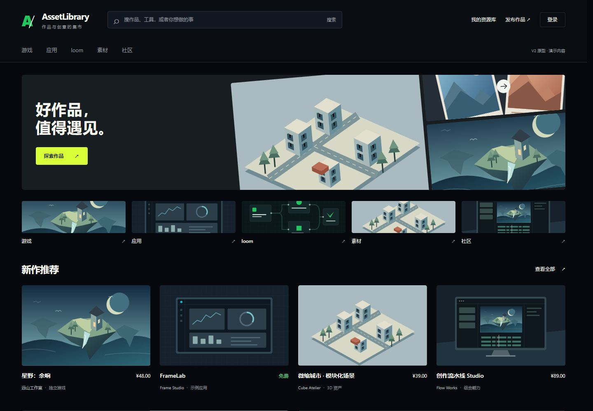

# AssetLibrary 市场布局参考 V2

保存日期：2026-10-24。状态：用户认可当前视觉方向，**只保存参考，暂不实施正式业务改版**。

本目录冻结本次快速迭代后的独立 HTML 原型与截图，供后续设计、讨论和开发时对照。
它不是正式站点、产品功能交付或新的开发启动指令，不替代现有 API、权限、数据与部署合同。
后续需要正式实现时，再根据当时的用户授权与真实业务数据制定开发切片。

## 已确认的方向

- 定位为公共作品市场，同时提供不同应用自己的内容空间。可承载游戏、应用、素材，以及 Loom 的 Art、MCP 和能力包；轻量能力与复杂组合都可展示。
- 一级分类的名称和顺序固定为 **游戏、应用、loom、素材、社区**；顶部导航与首页分类入口保持一致。
- 横向导航、全局搜索、封面优先的作品浏览；不使用常驻应用侧栏，不做后台控制台式首页。
- 分类页直接呈现作品，移除面包屑、大标题、说明区和筛选栏。
- 减少文本型描述：列表保留封面、名称、作者、价格和必要类别；完整介绍、许可、适用环境放在详情中。
- 首页以短标题组织新作、工具与内容空间，不把共享资产后端等架构目标写成首页说明面板。
- 应用与游戏内容空间允许不同结构和专属扩展入口，不把所有内容强行套进同一种精细能力模型。
- 社区以作品相关的内容流为主，浏览态不放文章摘要；阅读正文和关联作品按需展开。
- 继续遵循 Neuro 颜色与语义基线；本目录的 tokens 是原型快照，不是新的跨项目设计规范。

## 本地查看

无需安装依赖。在仓库根目录运行：

```powershell
rtk proxy node design/market-v2/prototype/server.cjs 0
```

打开终端输出的 `PROTOTYPE_URL`。服务只监听 `127.0.0.1`，按 `Ctrl+C` 停止；不应部署到正式环境。
不要直接使用 `file://` 打开，浏览器可能限制跨文件 SVG symbol。

在输出地址后添加以下片段即可查看各页面：

| 页面 | 地址片段 |
| --- | --- |
| 首页 | `#home` |
| 游戏、应用、loom、素材 | `#browse/game`、`#browse/application`、`#browse/loom`、`#browse/asset` |
| 社区 | `#community` |
| Loom 内容空间 | `#app/loom` |
| 游戏内容空间 | `#app/starfield` |
| 我的资源库 | `#library` |

## 截图

| 页面 | 桌面 | 手机 |
| --- | --- | --- |
| 首页 | [1440px](screenshots/home-1440.jpg) | [390px](screenshots/home-390.jpg) |
| 应用分类 | [1440px](screenshots/applications-1440.jpg) | — |
| Loom 内容空间 | [1440px](screenshots/loom-1440.jpg) | — |
| 游戏内容空间 | [1440px](screenshots/game-1440.jpg) | — |
| 社区 | [1440px](screenshots/community-1440.jpg) | [390px](screenshots/community-390.jpg) |



## 原型与正式实现的边界

所有作品、价格、作者、封面和社区帖子都是演示内容，不代表真实账号、资源、授权或平台交易。
可点击分类、搜索、详情、空间栏目与本地预览弹窗；获取、购买、发布、分享和收藏都没有真实业务副作用。
原型不登录、不上传、不创建订单、不下载、不安装、不读取用户文件、不接入正式 API。
付费交易、第三方发布、社区和共享资产后端是产品方向，不因本次归档就视为已实现或已确定技术合同。

`prototype/` 与 `screenshots/` 不在当前 Worker、TypeScript、Biome 和运行测试的活动路径中；没有新增依赖、构建入口、API、Schema 或部署配置。
本目录仅供对照，后续不能把演示数据或原型交互直接当作生产行为接线。

## 快照验证

归档前的同字节原型已完成 90 项页面检查、28 项社区检查及 121 项静态检查，均通过。
页面检查覆盖 1440、1024、768、390、320px，无横向溢出，首页标题与按钮完整显示；搜索、弹窗、焦点恢复及演示边界已检查。
归档时逐文件核对 17 个原型文件和 7 张截图的 SHA-256，确保与本次交付的参考一致；本地日志、浏览器缓存和临时测试脚本不进入仓库。
`responsive.css` 约 526 行，集中保存原型各断点覆盖；保留单一职责与已有窄屏保护检查，不作为生产样式组织方式的要求。
这些检查只证明原型快照可运行，不代表正式业务、生产部署或后续所有细节均已验收。
